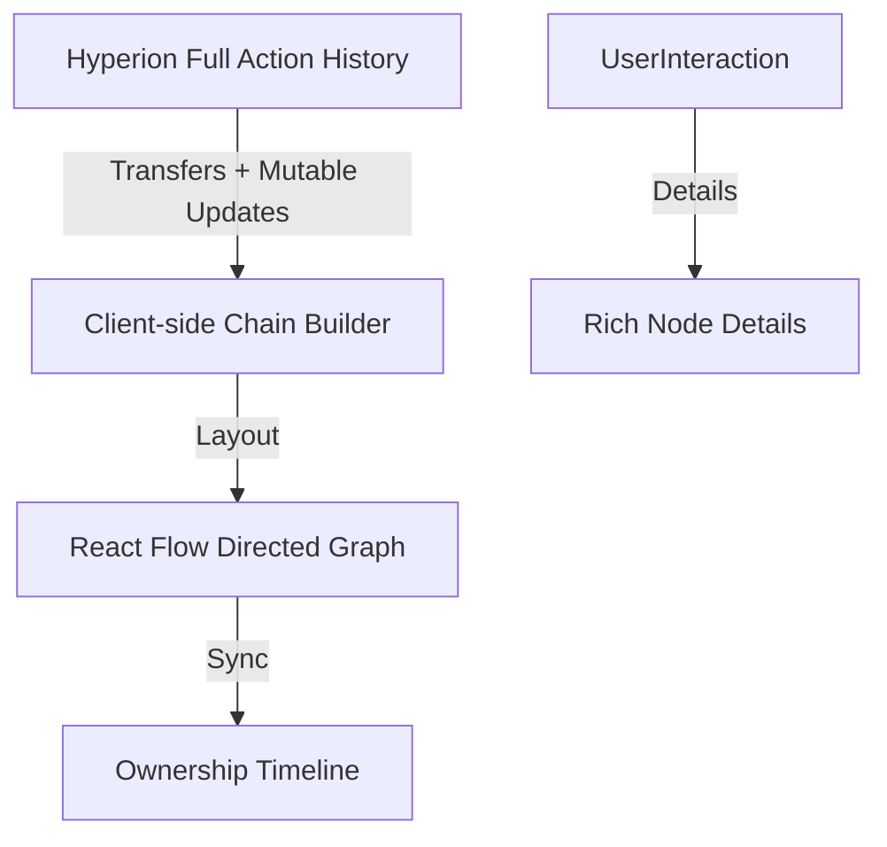

# wax-rwa-provenance-genealogy-tree — RWA Provenance & Ownership Genealogy Tree

> **Status:** 🔒 Private (In Development) | Target Public Release: August 2026  
> **Category:** Phygital (RWA) Redemptions & Supply-Chain Legibility  
> **Parent Catalog:** [pixel-journey/wax-ecosystem-blueprint-catalog](https://github.com/pixel-journey/wax-ecosystem-blueprint-catalog)

**One-sentence goal:** A beautiful interactive directed graph and timeline that maps the complete ownership and custody journey of a real-world asset across secondary markets, corporate vaults, previous collectors, and on-chain transfers, giving full transparent provenance directly from public AtomicAssets and Hyperion data.

---

## 1. Overview & Goal

This blueprint delivers a visual "family tree" of ownership for high-value phygital and RWA items. It answers: Who has owned this physical object? When did it change hands? Where has it been?

- **Why it matters for WAX:** Provenance is everything for collectibles and RWAs. Beautiful, verifiable on-chain history dramatically increases trust and secondary market value.
- **Public infrastructure only:** AtomicAssets for asset transfers and mutable custody updates, Hyperion for complete action history, client-side graph rendering. No custom contracts.
- **Target users:** Serious collectors, authenticators, insurers, secondary market platforms, brands wanting to showcase item history.
- **Success metrics:** "See full ownership genealogy in <3s", "Beautiful shareable provenance visuals", "Increase secondary sale prices through verified history".

---

## 2. Concepts & Inspiration

- **Core concepts:** Every transfer, burn-to-claim, or mutable custody update creates a node/edge in the ownership graph. Hyperion provides the chronological chain. Mutable data can add real-world context (vault locations, authenticator signatures).
- **Pain points:** Current provenance is often just a list of tx hashes. No beautiful visual story of an item's life.
- **Inspirations:** Traditional art provenance ledgers, blockchain explorers with graph views (e.g. Etherscan token trackers), family tree visualizations. Web3: rich interactive directed graphs from public data.
- **Cross-references:** Perfect with `wax-phygital-wear-and-tear-ledger`, `wax-warranty-expiry-countdown-clock`, `wax-escrowed-merch-custody-timeline`, and `wax-geolocated-drop-claim-map`.

---

## 3. Design Specifications (Pixel Journey Standards)

### 3.1 Visual & Interaction Design
- Elegant directed graph (React Flow or similar) showing ownership nodes connected by transfer edges.
- Timeline view synced with the graph for chronological scrubbing.
- Color coding: Original minter, corporate vaults, individual collectors, current holder highlighted.
- Micro-interactions: Hover node shows details (tx hash, date, location if available); click expands full asset history.
- Responsive: Graph on desktop; simplified vertical timeline on mobile.

### 3.2 Key Views / Components
- `ProvenanceGraph.tsx` — Main interactive directed graph.
- `OwnershipTimeline.tsx` — Synced vertical timeline with events.
- `NodeDetailPanel.tsx` — Sidebar with rich details and proof links.
- `ExportProvenance.tsx` — Beautiful PDF/image export for certificates or social sharing.

### 3.3 Accessibility (A11y) & Inclusive Design
- WCAG 2.2 AA: Alternative data table view of the full chain, keyboard navigation through nodes, screen reader descriptions of ownership flow.
- High contrast edges and labels.

### 3.4 Performance & Optimization Targets
- Efficient graph rendering with virtualization for long histories.
- Client-side layout calculation; cached Hyperion queries.
- Smooth interactions even with 50+ ownership events.

---

## 4. Technical Architecture

### 4.1 Core Tech Stack
- Next.js 15 + TypeScript + Tailwind + shadcn/ui
- React Flow (or @xyflow/react) for beautiful directed graphs
- @tanstack/react-query
- Hyperion for complete transfer history
- date-fns for timeline

### 4.2 Data Flow Diagram


### 4.3 Folder Structure
```
app/
├── components/
│   ├── provenance/
│   │   ├── ProvenanceGraph.tsx
│   │   ├── OwnershipTimeline.tsx
│   │   └── NodeDetailPanel.tsx
├── hooks/useProvenanceTree.ts
├── lib/wax/
│   ├── hyperion-provenance.ts
│   └── graph-builder.ts
└── types/provenance.ts
```

### 4.4 Security & Privacy
- Purely public data. Optional anonymization for older owners if desired by brands.

---

## 5. Implementation Examples & Code Snippets

**Core provenance builder**
```ts
// hooks/useProvenanceTree.ts
export function useProvenanceTree(assetId: string) {
  return useQuery({
    queryKey: ['provenance', assetId],
    queryFn: async () => {
      const actions = await fetchHyperionActions(assetId);
      return buildOwnershipChain(actions);
    }
  });
}
```

**Graph rendering (high-level)**
```tsx
<ReactFlow nodes={nodes} edges={edges} />
```

---

## 6. Demo & Testing
- Mock data with rich multi-owner history for a sample high-value phygital item.
- Live mode with real Hyperion data.
- Interaction tests: node click, timeline scrub, export.
- Edge cases: long chains, corporate vault nodes, mutable context additions.

---

## 7. Roadmap
Phases: data chain builder → graph + timeline UI → polish, export, a11y → full documentation.

Future: Animated playback of ownership history, integration with wear/tear and warranty views, public API for secondary marketplaces.

---

## 8. Visual References
> Stunning directed graphs like family trees or blockchain lineage visualizers (e.g. in advanced NFT explorers) meets clean modern dashboard. Elegant lines, clear node icons (person, vault, brand), beautiful typography. Reference: art provenance tools + React Flow examples + high-end genealogy sites.

---

## 9. Related Blueprints
- `wax-phygital-wear-and-tear-ledger` + `wax-warranty-expiry-countdown-clock` — Full item lifecycle view.
- `wax-escrowed-merch-custody-timeline` — Custody handoff layer.
- `wax-geolocated-drop-claim-map` — Geographic context on the journey.

---

## 10. License & Credits
MIT. Built to make RWA provenance beautiful and accessible on WAX.

**Pixel Journey — Beautiful interfaces for public blockchain data.**
